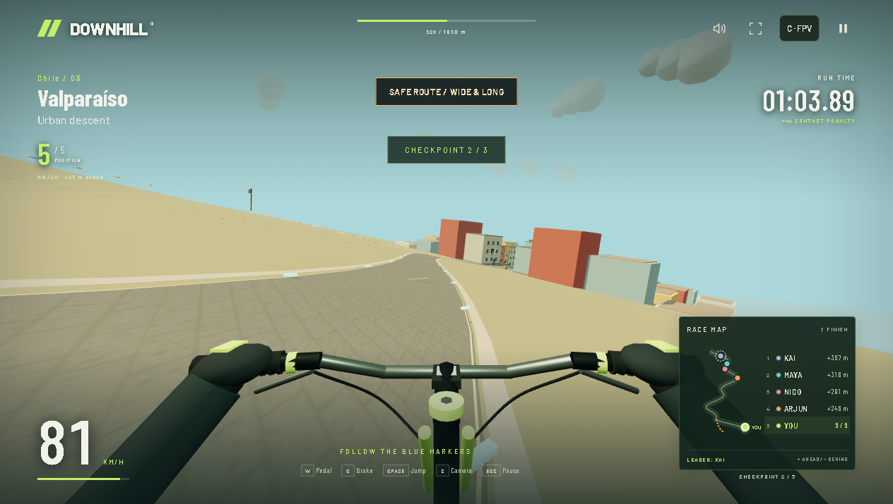

# DOWNHILL — Urban FPV — offline mirror

Full mirror of **DOWNHILL — Urban FPV** (https://downhill-eta.vercel.app/), a
first-person downhill racing game built in three.js.

Source: https://downhill-eta.vercel.app/



## §0.4 note — the repo the game links does not exist (dead link, no fork path)

Prominent finding (checked 2026-10-13, per the fleet's fork-over-mirror rule):
the served menu footer credits the author and links a "GitHub repo ↗":

- **Reference in the served source**: `src/main.js` line 54 renders
  `Created by <a href="https://github.com/msreekm">Sree Menon</a> ·
  <a href="https://github.com/msreekm/downhill">GitHub repo ↗</a>` — so the
  deploy *declares* **https://github.com/msreekm/downhill** as its repository.
- **Repo URL**: https://github.com/msreekm/downhill — `gh api
  repos/msreekm/downhill` → **HTTP 404 Not Found** (removed, renamed or never
  public; no redirect).
- **Homepage field**: not available — there is no repository to read it from.
- **License**: not retrievable — no repository; the only license text in the
  capture is three.js's MIT header inside `vendor/three.core.min.js`.
- **Is the deploy that repo's build?** Unprovable now. The deploy is a
  hand-written ES module tree (named modules, comments, JSDoc) served by
  Vercel, consistent with the self-declared credit, but with the repo 404 there
  is no build/source to compare against.
- **No hidden sibling repo**: the GitHub user `msreekm` ("sreekumar menon")
  exists with 68 public repos; none of the 68 names matches downhill/FPV/drop.

Consequence: the fork-over-mirror rule (PLAN §0.4) applies only when a public
repo exists — here it does not, so **the mirror stands and is the only
preservation of this deploy's source-visible build**. The coordinator decides
any fork/retire question separately (recorded in `_mirror-report.json`).

## Stack

- **Hand-written ES module graph, no bundler** — the entry document carries an
  inline import map (`three` → `/vendor/three.module.min.js`,
  `three/addons/utils/BufferGeometryUtils.js` → `/vendor/BufferGeometryUtils.js`)
  and loads `/src/main.js`, which pulls the other fifteen app modules through
  static imports
- **three.js r183 in `vendor/`** — `three.module.min.js` (the WebGL renderer
  module, which imports `three.core.min.js`) plus the `BufferGeometryUtils`
  addon the world builder merges geometry with, all byte-exact
- **Everything else is procedural** — the twelve courses are generated from
  seeds in code (`src/game.js`, `src/world.js` and the per-theme world
  builders), textures are painted to canvases, audio is synthesized with
  WebAudio (engine noise + an oscillator crowd); the only binary payloads are
  three Roku poster JPGs used by the billboard ad system
- **Vercel static host** — root-served; served path == disk rel

## What this is

DOWNHILL — Urban FPV (downhill-eta.vercel.app) — "City streets, wild trails,
and extreme drops. All 12 rides, one place.": an FPV downhill race on a bike
through twelve seed-built courses — city descents (Valparaíso, Aizawl, Dharavi,
Tokyo, Bengaluru Traffic), wild trails (Pacific Coast, Redwood Forest,
Yosemite, Rocky Mountains, Amazon After Dark), a Halloween night ride with
skeleton racers, zombies, pumpkins and bats (Hallow's Descent) and a 20-second
survival drop (Dead Air) — against five AI riders, with medals, forks/shortcut
choices, jump gaps, traffic and a localStorage personal best. The site is not a
build artifact: the served code is the authored source (named modules,
comments, JSDoc), so the mirror preserves both the running game and a readable
record of it.

The capture is the whole runtime closure: **24 files, 1,054,867 bytes (~1.0
MiB)** — the entry document, the sixteen `/src/` app modules, the stylesheet,
the three vendored three.js files and the three Roku poster JPGs. Closure was
iterated to fixpoint (static/bare/dynamic import scan — with the entry import
map resolving bare specifiers — plus `new URL(..., import.meta.url)`,
`fetch()` literals, CSS `url()`/`@import` and asset-path string literals) and
cross-checked against the live browser's resource log while *playing* the game:
every same-origin request the game makes is one of the 24 captured files, zero
404s, zero new requests during gameplay.

External: `fonts.googleapis.com` webfont CSS (`Barlow` / `Barlow Condensed`) is
`@import`ed by `src/style.css` and stays external per fleet rule (CDN
dependencies are never backfilled into the capture; the gothic/HUD stack has
system fallbacks). The Roku CDN poster URLs and the author/repo links inside
`src/roku-lineup.js` / `src/main.js` are data strings, never fetched at
runtime.

## Layout

- `index.html` — the entry document as served (byte-exact); inline importmap,
  then `<script type="module" src="/src/main.js">`
- `src/` — the sixteen app modules as served (byte-exact capture): `main.js`
  (integrator: boot, renderer, input, HUD/menus, frame loop), `game.js` (rules:
  courses, run physics, racers, scoring), `world.js` (world builder) and the
  per-theme builders `fork-world.js`, `sky-world.js`, `halloween-world.js`,
  `bengaluru-world.js`, `amazon-world.js`, plus `cameras.js`, `racers.js`,
  `impacts.js`, `billboards.js`, `billboard-layout.js`, `roku-lineup.js`,
  `race-map.js`, `route-links.js`, `style.css` — **plus** the 24 derived
  statement-aligned slices `src/src__<module>-NN.js` (layout divergence: the
  origin serves the app under `/src/`, so capture and derived slices share the
  directory; derived names are `src__<module>-NN.js` and are never listed in
  the manifest)
- `src/assets/roku/` — the three billboard poster JPGs (byte-exact)
- `vendor/` — `three.module.min.js`, `three.core.min.js`,
  `BufferGeometryUtils.js` (all byte-exact)
- `readable/` — prettified derived layer (pinned prettier 3.9.6, module API):
  20 `*.pretty.js|css` twins + `index-inline-1.pretty.json` (the importmap) +
  `index-inline-map.json` (byte range + sha256)
- `.upstream/manifest.json` — Gen-A sha256 record for all 24 captured files
  (plus `.upstream/capture-log.json`, the capture tool's own log)
- `split-spec.json` — the derivation record (29 sections, sources, inline map)
- `tools/capture.mjs` — reproducible BFS capture (and `--scan` closure round)
- `tools/derive.mjs` — rebuild `readable/` + `src/` + `split-spec.json`
- `tools/verify.mjs` — re-hash the capture against the manifest
- `tools/update.mjs` — read-only drift probe against the live origin
- `tools/audit.js` — integrity gate for the derived layers (`AUDIT PASS`)
- `tools/vendor/prettier/` — the pinned renderer (prettier **3.9.6**, module
  API) this mirror's `readable/` + `src/` were produced with, vendored INTO the
  mirror and committed, so `tools/derive.mjs` / `tools/audit.js` never reach
  into a sibling mirror's tree. Provenance and the exact npm integrity hash:
  `tools/vendor/prettier/VENDOR-README.md`. No install step is needed — the
  renderer is already in the tree.
- `docs/cover.png`, `docs/boot-2026-10-13.png` — cover + boot evidence (both
  captured in actual gameplay on the served mirror: FPV at 81 km/h through
  Valparaíso checkpoint 2/3, and the sunlit descent leading the pack)

## Assets

- **images** — 3 file(s): `src/assets/roku/` (hotel-transylvania.jpg,
  hotel-transylvania-2.jpg, madagascar.jpg) — billboard poster art for the
  in-game Roku ad slots
- **fonts** — none captured: `src/style.css` `@import`s Google Fonts
  (Barlow / Barlow Condensed) from the CDN, which stays external
- **audio** — none: engine, crowd and stingers are synthesized at runtime with
  WebAudio
- **models** — none: all geometry (roads, buildings, riders, props, zombies,
  pumpkins, animals) is generated in code from per-course seeds
- **textures** — none: painted to canvases at boot

## Run

Serve the repo root with any static file server (the capture is a static site;
no build step):

```
npx serve .
```

The game boots at `http://localhost:3000/`. Course deep links work as upstream
(`/?valparaiso`, `/?redwood-forest`, `/?hallows-descent`, …), `W/S` pedal/brake,
`A/D` steer, `SPACE` jump/recover, `C` camera, `ESC` pause, `R` restart.

## Verify

```
node tools/verify.mjs     # re-hash the capture against the manifest
node tools/audit.js       # derived-layer integrity gate
node tools/check-exports.mjs   # the derived layer still exports every public name
```

Last run: `24 files checked, 0 problems` and `AUDIT PASS  — 29 spec sections
(24/24 src↔pretty round-trips byte-exact, 21/21 pretty sources tiled
contiguously, 24/24 derived slices + 19/19 readable/*.pretty.js parse
standalone, 16 captured src/ modules on disk, 20/20 pretties provably distinct
from their capture source, 5 index-only wholeFile sections carry no src file,
1 inline content block with twin + index-inline-map.json, 42/42 imports resolve
inside the capture, 21/21 pretties re-render byte-exact under pinned prettier
3.9.6)`.

### Export-name coverage (measured 2026-10-27)

`node tools/check-exports.mjs` reports **63 export tables checked, 4 NOT
covered, 0 public names lost** (`checked=63 uncovered=4 lost=0`; the fleet's
coverage instrument independently measures `captureTables=67 blind=0`). The
same record is in `split-spec.json` under `coverageNote`.

- **63 checked** — every app module's export table is compared against a
  *different* file: the pristine is its prettier reading copy under
  `readable/`, the derived text is its statement-aligned
  `src/src__<module>-NN.js` slice. Renaming a public name on either side turns
  the gate red and names the file and the binding (proven in a throwaway copy:
  `ROKU_CHECKED_ON` → `ROKU_CHECKED_ON_X` produced
  `readable/src__roku-lineup.pretty.js: a public export name was LOST:
  ROKU_CHECKED_ON`, exit 1).
- **4 NOT covered** — the vendor export tables: `vendor/three.module.min.js`
  (2 tables, 243 + 197 public names), `vendor/three.core.min.js` (1 table, 442
  names) and `vendor/BufferGeometryUtils.js` (1 table, 13 names). The vendor
  rule ships these files byte-exact and renders each whole to
  `readable/vendor__<name>.pretty.js`, never sliced — the reading copy **is**
  the layer's terminal text, so there is no derived file downstream to compare
  and comparing it with itself is the self-compare the gate refuses. Naming the
  served capture a second time counts the same table twice (measured 4 → 8
  NOT covered) and is not done: **one table, one name**.
- **Importer evidence** that all four are load-bearing: the entry document's
  import map maps `three` → `/vendor/three.module.min.js` and
  `three/addons/utils/BufferGeometryUtils.js` → `/vendor/BufferGeometryUtils.js`;
  eight app modules `import * as THREE from 'three'`; `src/world.js` imports
  `mergeGeometries` from the addon; `vendor/three.module.min.js` imports
  `./three.core.min.js`.
- **Their bytes are still watched**: `tools/verify.mjs` re-hashes all 24
  captured files against `.upstream/manifest.json` (a renamed vendor name turns
  the integrity gate red), and `tools/audit.js` resolves all 42 imports
  (including the 2 import-map entries) and keeps the vendor sections' content
  guards.

## Boot test (2026-10-27)

- Entry: `http://127.0.0.1:4774/` served by `tools/serve.mjs` (root = repo root,
  matching the origin's absolute `/src/` and `/vendor/` paths) with the network
  blocked (`MAP * 127.0.0.1`).
- Outcome: **rendered** — the full location menu appeared, and clicking "LET'S
  RIDE" launched Hallow's Descent into live gameplay (bike handlebars, HUD,
  race map, 53 km/h, position 5/5, run clock advancing).
- Evidence: body 424 chars (gameplay HUD) / 1214 chars (menu); canvas
  1262x568; 0 console errors; 0 failed same-origin requests, 1 blocked
  cross-origin request (the `fonts.googleapis.com` Barlow stylesheet, expected
  under the offline rule); screenshot `docs/boot-2026-10-27.png`.
- Gaps seen: none.

This re-confirms, offline and from a freshly added server, the 2026-10-13
served-mirror boot record below — the capture is fully self-contained for boot
and gameplay, and no "playable build absent/gated" claim exists to confirm or
refute. The one cross-origin dependency remains the CDN webfont stylesheet,
which has system fallbacks and does not affect rendering.

## Updating from upstream

```
node tools/update.mjs     # read-only drift probe: what changed upstream
```

The probe never rewrites the capture — a mirror is a point-in-time snapshot.
Refreshing means re-running `node tools/capture.mjs` (BFS closure to fixpoint;
`--scan` re-checks it), copying every replaced file into `legacy/<date>/`,
re-cutting `.upstream/manifest.json`, then re-deriving `readable/` + `src/`
from the new bytes with `node tools/derive.mjs`. Known noise:
`_mirror-report.json` and `.upstream/capture-log.json` are local records and
are excluded from probing by name in `tools/update.mjs`.

### 2026-10-13 readable/src derivation

Both queued derived layers are in place, cut from the recorded capture
(capture bytes untouched — `node tools/verify.mjs` re-hashes all 24 files):

- `readable/` — pinned prettier 3.9.6 (module API, default options, single
  pass verified idempotent — never the CLI, it respects `.gitignore` and can
  silently echo its input) rendered all 19 captured JS files + the stylesheet
  to `*.pretty.js` / `*.pretty.css` (20 files, 41,176 lines) and the entry's
  inline importmap to `readable/index-inline-1.pretty.json` (1 more twin).
  Names are capture-relative with `/` flattened to `__` (`src__main`,
  `vendor__three.module.min`, …). Every pretty is provably not a byte copy of
  its capture source, and 21/21 re-render byte-exact under the pinned version.
- `src/` — 24 statement-aligned slices (`src/src__<module>-NN.js`, exact
  2-line provenance header) across the sixteen app modules, recorded in
  `split-spec.json` (29 sections): 24/24 parse standalone (`node
  --input-type=module --check -`) and round-trip byte-exact to their readable
  line ranges. Cuts land only on top-level declaration boundaries (~250-350
  line windows); oversized single declarations stay whole (e.g. `src__world`
  yields just 2 slices because its builder declaration spans lines 38-2051;
  the entry `src__main` yields 3). Identifiers are the app's own declared
  names — the served code is not minified, so no rename campaign (PLAN §5)
  applies.
- Vendor rule — wholeFile sections, never sliced: the three.js r183 build
  (`vendor/three.module.min.js`, guarded on the `three.core.min.js` import +
  `WebGLRenderer`; `vendor/three.core.min.js`, guarded on the r183 revision
  string + `BufferGeometry`) and the `BufferGeometryUtils` addon (guarded on
  `@three_import` + `mergeGeometries`). Stylesheet rule: `src/style.css` is
  wholeFile. Inline rule: the importmap twin + `index-inline-map.json` carry
  the byte range + sha256. 3 `notRendered` payloads (the Roku JPGs, hashed).
  No skipped sections — no app module ends in a bare export table.
- Layout divergence (recorded): the origin serves the app under `/src/` and
  the libraries under `/vendor/`, so the byte-exact capture lives at
  `src/*.js` + `vendor/**` at the repo root (`DISK_PREFIX=""`) and the derived
  slices share `src/` with the captured modules. `tools/audit.js` asserts the
  split exactly: `src/` on disk == 16 captured modules (manifest-listed,
  byte-exact) ∪ 24 ranged slices (`src__<module>-NN.js`, never in the
  manifest).
- Gates: `node tools/verify.mjs` → `24 files checked, 0 problems`;
  `node tools/audit.js` → `AUDIT PASS` (see Verify above); `node
  tools/update.mjs` → `up to date: 24 captured files identical upstream`;
  serve probe — mirror root served on loopback, all 24 captured files over
  HTTP 200 with zero 404s, game booted and the full Valparaíso course played
  to the finish (GOLD RUN, 01:26.82, new personal best), listener killed and
  port 4390 proven closed (netstat + connection refused). Cover and boot
  evidence are real gameplay from the served mirror (`docs/cover.png` at 81
  km/h through checkpoint 2/3, `docs/boot-2026-10-13.png` on the sunlit
  descent leading the pack); the live-origin and served-mirror resource logs
  both matched the 24-file capture exactly. Rebuild with `node
  tools/derive.mjs`.
- §0.4 fork-over-mirror checked 2026-10-13: `src/main.js` links
  github.com/msreekm/downhill as the project repo, but that repository answers
  404 (the `msreekm` user exists; none of their 68 public repos matches) — no
  public source and no fork path, so the mirror stands. Full finding in the
  §0.4 note above.

## Mirror conventions

- **Capture layer** — the captured files are byte-exact copies of what the
  origin served; nothing in them is edited. Vendor files (three.js r183, the
  addon) stay byte-exact exactly as served — never re-minified or re-hosted.
- **Readable layer** — `readable/` is derived (prettified) and never shipped
  to a browser; it exists so the served code can be read in one place.
- **Provenance** — `.upstream/manifest.json` records sha256 for each captured
  artifact, and `tools/verify.mjs` re-checks it.
- **Drift** — `tools/update.mjs` is read-only: it reports what changed
  upstream and never rewrites the capture.
- **Layout divergence** — the capture lives at the repo root (`index.html`,
  `src/`, `vendor/`) because the origin serves it there; the derived slices
  share `src/` with the captured modules and are distinguished by their
  `src__<module>-NN.js` names (never manifest-listed).

## Fleet status

<!-- mirror-status:start — feeds _standard/REPO-INDEX.md. Update ONLY your own mirror's block; never edit the shared index (PLAN §8). Rebuild: node _standard/build-index.mjs -->
<!-- cols: cls=classification · ver=verify 0 problems · upd=drift probe · man=manifest · rdbl=readable re-derived · src=reversed src · boot=boot test · top=offline-mirror topic · tag=legacy bundle date · staged=staged not committed -->
| # | repo | cls | ver | upd | man | rdbl | src | boot | top | tag | staged |
|---|---|---|---|---|---|---|---|---|---|---|---|
| 300 | downhill | mirror | ✓ | ✓ | ✓ | ✓ | ✓ | ✓ | ✓ | — | — |
<!-- mirror-status:end -->
